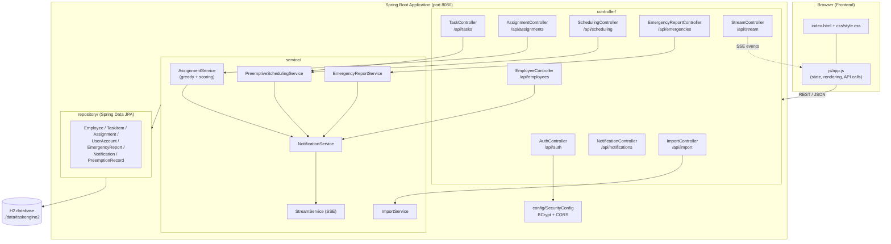
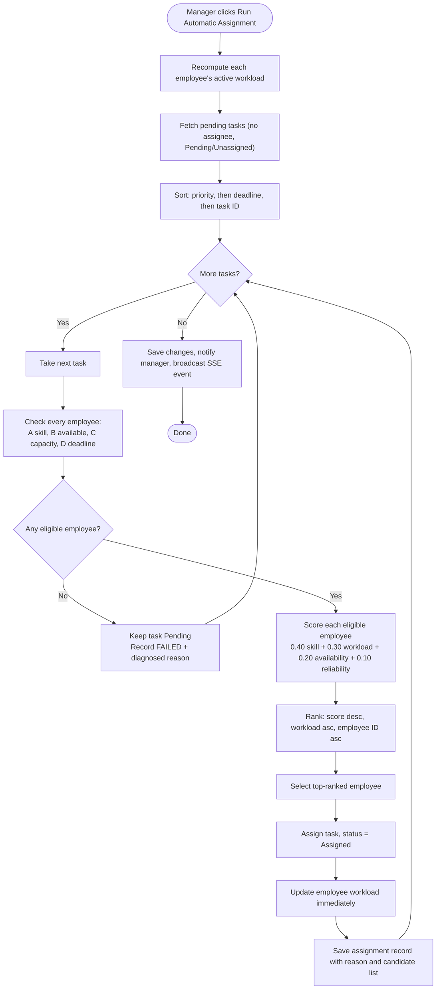
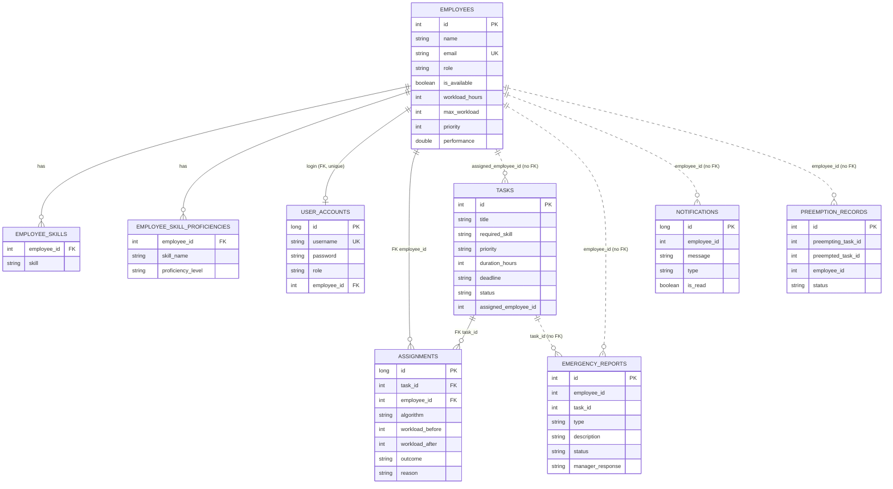

<div align="center">

# TaskFlow
### Dynamic Task Assignment and Scheduling Engine

*Automatically assign tasks to the right employee, based on skills, availability, workload and deadlines.*


-blue)


</div>

---

## Table of Contents

1. [Project Overview](#1--project-overview)
2. [Key Features](#2--key-features)
3. [Technology Stack](#3--technology-stack)
4. [System Architecture](#4--system-architecture)
5. [Algorithms and Data Structures](#5--algorithms-and-data-structures)
6. [User Roles and Workflow](#6--user-roles-and-workflow)
7. [Project Folder Structure](#7--project-folder-structure)
8. [Database Design](#8--database-design)
9. [Installation and Setup](#9--installation-and-setup)
10. [Application Usage](#10--application-usage)
11. [Testing](#11--testing)
12. [Known Limitations](#12--known-limitations)
13. [Future Enhancements](#13--future-enhancements)

---

## 1.  Project Overview

**TaskFlow** is a web-based task assignment and scheduling system. It automates the allocation of tasks to employees by evaluating each employee's **skills**, **availability**, **current workload** and the task's **deadline**.

Managers maintain the employee roster, create tasks, trigger automatic assignment and monitor progress. Employees log in to see their own tasks, start and complete them, and report emergencies or problems that prevent them from continuing.

### The problem it solves

In manual task allocation, managers must remember who has which skills, who is free, and who is already overloaded. This leads to:

- tasks given to people without the right skill,
- overloaded employees while others sit idle,
- missed deadlines that nobody notices until too late,
- no record of *why* a task was given to a particular person.

### Main objectives

| Objective | How TaskFlow addresses it |
|---|---|
| Automate allocation | One-click **Run Automatic Assignment** processes every pending task |
| Match the right person | Skill matching, availability and capacity are hard constraints |
| Balance workload | A weighted score favours less-loaded employees; workload is updated after each assignment |
| Respect urgency | Tasks are processed by priority, then deadline |
| Be explainable | Every decision stores a reason, a score breakdown and a list of rejected candidates |
| Keep people informed | In-app notifications and real-time updates (Server-Sent Events) |

---

## 2.  Key Features

Each feature below was checked against the source code.

| # | Feature | Status | Where it lives |
|---|---|:---:|---|
| 1 | **User authentication**: separate manager and employee login | ✅ | `AuthController`, `UserAccount`, BCrypt |
| 2 | **Role-based interfaces**: different menus and pages per role | ✅ (UI-level, see [limitations](#12--known-limitations)) | `frontend/js/app.js` (`applyUserSession`) |
| 3 | **Employee management**: add, edit, delete, toggle availability, manage skills and proficiency | ✅ | `EmployeeController` |
| 4 | **Task management**: priority, required skill, duration, deadline, filters, search | ✅ | `TaskController` |
| 5 | **Automatic assignment** of pending tasks (greedy, sequential) | ✅ | `AssignmentService.runAssignment()` |
| 6 | **Workload balancing**: workload score, capacity limits, immediate workload update | ✅ | `AssignmentService` |
| 7 | **Skill matching** (case-insensitive) with proficiency levels | ✅ | `AssignmentService`, `Employee.skillProficiencies` |
| 8 | **Availability consideration**: unavailable employees are rejected | ✅ | `AssignmentService` |
| 9 | **Deterministic tie-breaking** (see [exact rules](#lexicographical--deterministic-tie-breaking)) | ✅ | `AssignmentService` |
| 10 | **Scheduling and tracking**: start, complete (with notes), status filters, history | ✅ | `TaskController`, `SchedulingController` |
| 11 | **Emergency reporting**: employee submits; manager acknowledges / resolves | ✅ | `EmergencyReportController` |

### Additional implemented features

- **Deadline feasibility checks** (expired deadlines and insufficient working hours are rejected)
- **Priority-based preemptive scheduling**: a new High/Critical task can pause a lower-priority task that is *In Progress*, which resumes automatically later
- **Manual reassignment** with a ranked list of recommended candidates
- **Assignment history / audit log** with CSV export
- **In-app notifications** and **real-time events** through Server-Sent Events (SSE)
- **Bulk import** of employees and tasks from `.csv` / `.xlsx`, with downloadable templates
- **Manager dashboard** with workload and task-status charts

---

## 3. Technology Stack

Taken from `backend/pom.xml`, `application.properties` and the frontend sources. TaskFlow does **not** use React, Node.js, Express or MongoDB.

| Layer | Technology |
|---|---|
| **Frontend** | HTML5, CSS3, Vanilla JavaScript (no framework, no build step, no CDN) |
| **Backend** | Java 17, Spring Boot 2.7.18 (REST API; also serves the frontend as static files) |
| **Database** | H2 (file-based, `./data/taskengine2`), accessed through Spring Data JPA / Hibernate |
| **Programming languages** | Java, JavaScript, HTML, CSS (PowerShell/Batch for helper scripts) |
| **Real-time** | Server-Sent Events (`SseEmitter`) |

### Libraries and frameworks

| Library | Version | Purpose |
|---|---|---|
| `spring-boot-starter-web` | 2.7.18 (managed) | REST controllers, embedded Tomcat |
| `spring-boot-starter-data-jpa` | 2.7.18 (managed) | ORM and repositories |
| `spring-boot-starter-security` | 2.7.18 (managed) | BCrypt password hashing, HTTP Basic, CORS |
| `spring-boot-starter-validation` | 2.7.18 (managed) | Bean validation |
| `h2` | managed | Embedded database, web console |
| `opencsv` | 5.9 | CSV import |
| `poi` / `poi-ooxml` | 5.2.5 | Excel (`.xlsx`) import and templates |

### Development tools

| Tool | Use |
|---|---|
| Apache Maven | Build and run (`spring-boot-maven-plugin`) |
| PowerShell / Batch scripts | Windows launchers and API test scripts |
| VS Code | Project settings present in `.vscode/` |

---

## 4. System Architecture

TaskFlow is a **single Spring Boot application**. It exposes a REST API under `/api/**` and serves the browser UI from `src/main/resources/static`. The browser talks to the API over HTTP/JSON and receives live updates over SSE.



### Layer descriptions

| Layer / module | Responsibility |
|---|---|
| **Frontend** (`index.html`, `css/style.css`, `js/app.js`) | Single-page UI. Holds application state, renders manager and employee views, calls the REST API, listens to SSE. |
| **Authentication and roles** (`AuthController`, `SecurityConfig`, `UserAccount`, `Role`) | `POST /api/auth/login` validates credentials against BCrypt hashes and returns the user's role (`MANAGER` / `EMPLOYEE`) plus a Basic-auth header. The UI switches layout by role. |
| **Employee management** (`EmployeeController`) | CRUD, availability toggle, skills and proficiencies. Creating an employee also creates their login account. |
| **Task management** (`TaskController`) | CRUD, filters, start / complete / status update. Creating a task triggers the preemption check. |
| **Automatic assignment engine** (`AssignmentService`) | Processes pending tasks, applies constraints, scores candidates, records history. |
| **Scheduling and status** (`PreemptiveSchedulingService`, `SchedulingController`) | Priority-based preemption, pause/resume, auto-resume on completion. |
| **Emergency reporting** (`EmergencyReportService`) | Stores reports (`OPEN` → `ACKNOWLEDGED` → `RESOLVED`) and notifies the manager / employee. |
| **Notifications and real-time** (`NotificationService`, `StreamService`) | Persists notifications and pushes events to connected browsers. |
| **Import** (`ImportService`) | CSV / Excel bulk import for employees and tasks. |
| **Database layer** (`repository/`, `DatabaseInitializer`) | JPA repositories; first-run seeding of demo data. |

---

## 5. Algorithms and Data Structures

### Greedy assignment with weighted scoring

`AssignmentService.runAssignment()` is a **greedy, sequential** algorithm. Tasks are handled one at a time in a fixed order. For each task the best eligible employee is chosen immediately and that choice is never revisited. The employee's workload is updated before the next task is evaluated, so later tasks see the new load.

> The code labels the successful-assignment algorithm as **"Weighted Multi-Criteria Suitability Heuristic"**.

#### Step by step

1. **Synchronise workloads.** Each employee's workload is recomputed as the sum of `durationHours` of their active tasks (`Pending`, `Assigned`, `In Progress`, `Paused`, `Emergency`).
2. **Retrieve pending tasks.** Tasks with no assigned employee and status `Pending` or `Unassigned`.
3. **Order the tasks.** Priority (Critical → High → Medium → Low), then earlier deadline first (no deadline last), then lowest task ID.
4. **For each task, evaluate every employee against four hard constraints** (checked in this order):

   | # | Constraint | Rejection category |
   |---|---|---|
   | A | Employee has the required skill (case-insensitive match) | `SKILL_MISMATCH` |
   | B | Employee is marked available | `UNAVAILABLE` |
   | C | `current workload + task duration ≤ max workload` | `CAPACITY_EXCEEDED` |
   | D | Deadline is feasible (see below) | `DEADLINE_INFEASIBLE` |

5. **Score every eligible employee** (0–100):

   ```
   Suitability = 0.40 × Skill + 0.30 × Workload + 0.20 × Availability + 0.10 × Reliability
   ```

   | Component | Weight | How it is computed |
   |---|:---:|---|
   | Skill | 0.40 | Proficiency for the required skill: Advanced = 100, Intermediate = 75, Beginner = 50 |
   | Workload | 0.30 | `(1 − workload / maxWorkload) × 100`. Lower load scores higher |
   | Availability | 0.20 | Remaining capacity margin *after* taking the task: `(max − (workload + duration)) / max × 100` |
   | Reliability | 0.10 | `70 + 30 × (completed / total past tasks)`; neutral **75** if the employee has no history |

   The weights are defaults in `AssignmentScoringConfig` (bound to the property prefix `taskflow.assignment.weights`, so they can be overridden in `application.properties`).

6. **Select the winner** using the sort order below (highest score first, then tie-breakers).
7. **Assign the task.** Set `assignedEmployeeId/Name`, status `Assigned`, update the employee's workload immediately.
8. **Record the decision.** An `Assignment` row stores workload before/after and a human-readable reason; the result also lists all eligible and rejected candidates.
9. **If nobody is eligible**, the task stays `Pending`, a `FAILED` assignment record is saved with the diagnosed reason (missing skill, all unavailable, insufficient capacity, or deadline cannot be met).
10. **Continue** with the remaining tasks, then send one summary notification to the manager and broadcast an SSE event.

#### Deadline feasibility rule

Deadlines are treated as dates. Available working time is estimated as `max(1, days remaining) × 8` hours. A task is rejected for an employee if the deadline has passed, if the task alone exceeds the available hours, or if `employee workload + duration` exceeds the available hours.

#### Lexicographical / deterministic tie-breaking

When several eligible employees are equivalent, the code resolves the choice with a fixed comparison chain so the same input always gives the same result:

| Order | Criterion |
|:---:|---|
| 1 | Higher suitability score |
| 2 | Lower current workload (hours) |
| 3 | Lower employee ID (numeric, ascending) |

This is an ordered, multi-key comparison (a lexicographic ordering over *(score, workload, id)*). It is **not** a separate algorithm and it is **not** FCFS. Note that the final key is the **numeric employee ID**, not an alphabetical comparison of names.

### Priority-based preemptive scheduling

`PreemptiveSchedulingService.evaluateAndSchedule()` runs when a task is created (and when a task's priority changes):

- It finds eligible employees using the same four constraints.
- If an eligible employee is currently running a **lower-priority** task, the lower task is **paused** (remaining hours and progress are saved), the new task is assigned and started, and a `PreemptionRecord` is stored.
- Among several preemption candidates it prefers lowest workload, then fewer active tasks, then higher employee priority, then higher performance, then lowest ID.
- If nothing can be preempted, the task stays `Pending` for the next automatic assignment run.
- When an employee completes a task, their highest-priority paused task is resumed automatically.

### Data structures

| Structure | Where used | Why |
|---|---|---|
| `List<Task>` / `ArrayList` | Pending tasks, eligible employees, results | Ordered collections that can be sorted and iterated sequentially |
| Comparator-based sort (`List.sort`) | Task ordering, candidate ranking | Implements the multi-key priority and tie-break rules |
| `HashMap<Integer, Integer>` | Employee ID → active workload (hours) | O(1) workload lookup and update while assigning |
| `Map<String, String>` (`skillProficiencies`) | Skill name → proficiency level | Constant-time proficiency lookup for scoring |
| `List<String>` (`skills`) | Employee skills | Simple skill list with case-insensitive matching |
| `HashMap<Integer, TaskItem>` | Employee → currently executing task (preemption) | Quick access to the task that might be paused |
| `Set<SseEmitter>` backed by `ConcurrentHashMap` | `StreamService` | Thread-safe registry of connected browsers |
| DTO / result objects (`AssignmentResult`, `EmployeeCandidateDto`, `EmployeeRejectionDto`, `CandidateScoringProfile`) | Assignment output | Carry score breakdowns and reasons to the UI |
| JPA entities | Persistence | Map objects to database tables |

### Operating-system-style concepts (application level)

TaskFlow borrows ideas from OS scheduling, but it is **not** an operating-system process scheduler. It schedules *work items for people*, not CPU processes.

| Concept | How it appears in TaskFlow |
|---|---|
| **Task scheduling** | Pending tasks are ordered and dispatched to employees one by one |
| **Priority handling** | Critical > High > Medium > Low; higher priority is processed first and can preempt lower-priority work |
| **Resource allocation** | Employees (with skills and capacity) are the resources; constraints decide who may receive a task |
| **Workload distribution** | The workload score and capacity cap spread work across eligible employees |
| **Preemption / context saving** | Paused tasks keep remaining hours and progress, and resume later |

### Assignment flowchart



---

## 6. User Roles and Workflow

### Manager

| Capability | Where in the UI |
|---|---|
| Log in (Manager Portal) | Login screen |
| Manage employees: add, edit, delete, mark available/unavailable, skills and proficiency, bulk import | **Employees** |
| Create, edit, delete and filter tasks; bulk import | **Tasks** |
| Trigger automatic task assignment and review the decision details (scores, rejected candidates, reasons) | **Tasks** (*Run Automatic Assignment*) |
| Reassign a task using ranked candidates | **Tasks** |
| Monitor progress and workload | **Dashboard**, **Workforce** |
| View, acknowledge and resolve emergency reports | **Emergencies** |
| View assignment history and export it to CSV | **Reports / History** |
| Receive notifications | Notification bell |

### Employee

| Capability | Where in the UI |
|---|---|
| Log in (Employee Portal) | Login screen |
| View assigned tasks and task details | **My Tasks**, **Dashboard** |
| Start a task (`In Progress`) and mark it complete (with optional notes) | **My Tasks** |
| See paused tasks and preemption messages | **Dashboard** |
| View personal history | **History** |
| Report an emergency (optionally linked to a task) | **Emergencies** |
| Receive notifications | Notification bell |

> Pausing and resuming a task is available through the API (`PATCH /api/scheduling/tasks/{id}/pause` and `/resume`); paused tasks are also resumed automatically when the employee completes another task.

---

## 7. Project Folder Structure

```text
TaskAssignmentSchedulingEngine/
├── README.md
├── run_project.bat              # Windows launcher (starts backend)
├── run_project.ps1              # PowerShell launcher (starts backend)
├── open_frontend.bat            # Opens http://localhost:8080/
├── .vscode/
│   └── settings.json
├── frontend/                    # Frontend source (copy is also in backend/.../static)
│   ├── index.html               # Single-page UI (all views and modals)
│   ├── css/style.css
│   └── js/
│       ├── app.js               # Main application logic (loaded by index.html)
│       ├── api.js               # Older API helper (not loaded by index.html)
│       └── main.js              # Older bootstrap script (not loaded by index.html)
└── backend/
    ├── pom.xml                  # Maven build and dependencies
    ├── run_project.bat
    ├── integration_test.ps1             # API test scripts (PowerShell)
    ├── enhanced_assignment_test.ps1
    ├── deadline_assignment_test.ps1
    ├── preemption_scheduling_test.ps1
    ├── data/                    # H2 database files (created at runtime)
    └── src/main/
        ├── java/com/taskengine/
        │   ├── TaskEngineApplication.java   # Spring Boot entry point
        │   ├── DatabaseInitializer.java     # Seeds manager, employees, sample tasks
        │   ├── DataStore.java               # Empty placeholder component
        │   ├── config/        # SecurityConfig, AssignmentScoringConfig
        │   ├── controller/    # Auth, Employee, Task, Assignment, Scheduling,
        │   │                  # EmergencyReport, Notification, Import, Stream
        │   ├── service/       # AssignmentService, PreemptiveSchedulingService,
        │   │                  # EmergencyReportService, NotificationService,
        │   │                  # StreamService, ImportService, CustomUserDetailsService
        │   ├── model/         # JPA entities + Role enum + AssignmentResult
        │   ├── repository/    # Spring Data JPA repositories
        │   └── dto/           # Request/response objects
        └── resources/
            ├── application.properties
            └── static/        # Frontend served by Spring Boot (index.html, css/, js/)
```

> Build output (`backend/target/`) and log files (`error.txt`, `backend-error.log`) also appear in the archive but are generated and are not part of the source.

### Important files

| File | Purpose |
|---|---|
| `AssignmentService.java` | The automatic assignment engine and scoring |
| `PreemptiveSchedulingService.java` | Preemption, pause/resume, scheduling status |
| `AssignmentScoringConfig.java` | Scoring weights (0.40 / 0.30 / 0.20 / 0.10) |
| `DatabaseInitializer.java` | Creates the default manager, 10 demo employees and 6 sample tasks on first run |
| `SecurityConfig.java` | BCrypt encoder, CORS, HTTP Basic configuration |
| `frontend/js/app.js` | All UI logic (~2,600 lines) |

>  `frontend/` and `backend/src/main/resources/static/` hold the same UI. Spring Boot serves the **static** copy, so edits made only in `frontend/` will not appear at `http://localhost:8080/` until they are copied across. The two `api.js` files differ, but `index.html` loads only `app.js`.

---

## 8.Database Design

- **Engine:** H2, file mode: `jdbc:h2:file:./data/taskengine2;AUTO_SERVER=TRUE`
- **Schema management:** Hibernate `ddl-auto=update` creates and updates tables automatically.
- **Console:** <http://localhost:8080/h2-console> (user `sa`, empty password).

### Tables

| Table | Purpose | Key fields |
|---|---|---|
| `employees` | Employee profile and capacity | `id` (PK), `name`, `email` (unique), `role`, `is_available`, `workload_hours`, `max_workload`, `priority`, `performance`, `version` |
| `employee_skills` | Skills per employee | `employee_id` (FK → employees), `skill` |
| `employee_skill_proficiencies` | Skill → level per employee | `employee_id` (FK), `skill_name`, `proficiency_level` |
| `tasks` | Tasks and their lifecycle | `id` (PK), `title`, `required_skill`, `priority`, `duration_hours`, `remaining_duration_hours`, `progress_percentage`, `deadline`, `status`, `assigned_employee_id`, `assigned_employee_name`, timestamps (`created_at`, `started_at`, `completed_at`, `paused_at`, `resumed_at`), preemption fields |
| `assignments` | Assignment history / audit log | `id` (PK), `task_id` (FK → tasks, nullable), `employee_id` (FK → employees, nullable), `algorithm`, `workload_before/after`, `outcome` (`SUCCESS` / `FAILED` / `PREEMPTED`), `reason`, `reassigned`, previous-employee fields |
| `user_accounts` | Login accounts | `id` (PK), `username` (unique), `password` (BCrypt), `role` (`MANAGER` / `EMPLOYEE`), `employee_id` (FK → employees, unique) |
| `emergency_reports` | Emergency / unavailability reports | `id` (PK), `employee_id`, `task_id`, `type`, `description`, `expected_unavailability`, `status`, `manager_response`, timestamps |
| `notifications` | In-app notifications | `id` (PK), `employee_id` (null = manager/global), `message`, `type`, `is_read`, `related_task_id`, `related_employee_id` |
| `preemption_records` | Audit of preemptions | `id` (PK), preempting/preempted task IDs, titles and priorities, `employee_id`, `status`, saved remaining hours and progress |

### How the main data is stored

| Information | Stored in |
|---|---|
| **Employees** (and skills, availability, capacity) | `employees`, `employee_skills`, `employee_skill_proficiencies` |
| **Tasks** | `tasks` |
| **Current assignment** | `tasks.assigned_employee_id` and `assigned_employee_name` |
| **Assignment history** | `assignments` |
| **Emergencies** | `emergency_reports` |

### Entity relationship diagram

Only `employee_skills`, `employee_skill_proficiencies`, `user_accounts` and `assignments` use real foreign-key constraints. The other links are plain integer columns that hold an ID without a database constraint (drawn as dotted lines).



---

## 9. ⚙️ Installation and Setup

### 1. Prerequisites

| Requirement | Version |
|---|---|
| JDK | **17** (as set in `pom.xml`) |
| Apache Maven | 3.6+ |
| Web browser | Any modern browser |
| Internet (first run) | Needed once to download Maven dependencies |

There is **no Node.js, npm or separate database server** to install.

### 2. Get the project

```bash
git clone <your-repository-url>
cd TaskAssignmentSchedulingEngine
```

*(Replace the URL with your repository. If you received the project as a ZIP, extract it and open a terminal in the extracted folder.)*

### 3. Dependencies

Maven downloads dependencies automatically on the first run. To fetch them in advance:

```bash
cd backend
mvn dependency:resolve
```

### 4. Environment variables

**None are required.** All configuration is in `backend/src/main/resources/application.properties`:

| Property | Default |
|---|---|
| `server.port` | `8080` |
| `spring.datasource.url` | `jdbc:h2:file:./data/taskengine2;AUTO_SERVER=TRUE` |
| `spring.datasource.username` / `password` | `sa` / *(empty)* |
| `spring.jpa.hibernate.ddl-auto` | `update` |
| `spring.h2.console.enabled` | `true` (path `/h2-console`) |
| `spring.servlet.multipart.max-file-size` | `25MB` |

Optional: override the scoring weights by adding properties such as `taskflow.assignment.weights.skill-weight=0.40` (the four weights are intended to sum to 1.0).

### 5. Database configuration

No manual setup. On first start, H2 creates `backend/data/taskengine2.mv.db`, Hibernate creates the tables, and `DatabaseInitializer` seeds:

- the manager account,
- 10 demo employees with login accounts,
- 6 sample pending tasks.

> Run the application from the `backend/` directory so that `./data` resolves to `backend/data`.

### 6 & 7. Start the application (backend and frontend together)

The frontend is served by the Spring Boot backend, so **one command starts everything**:

```bash
cd backend
mvn spring-boot:run
```

Wait for the log line `Started TaskEngineApplication`.

**Windows shortcut:** `run_project.bat` / `run_project.ps1` in the project root start the backend. Before using them, note that:

- they set `JAVA_HOME` to a hard-coded path (`C:\Program Files\Eclipse Adoptium\jdk-17.0.19.10-hotspot`), so edit it to match your JDK;
- they run Maven in **offline** mode (`mvn -o`), so dependencies must already be in your local Maven repository;
- `run_project.ps1` stops **all** running `java` processes, and `run_project.bat` frees ports 8080/8081.

### 8. Open the application

| What | URL |
|---|---|
| TaskFlow UI | <http://localhost:8080/> |
| H2 database console | <http://localhost:8080/h2-console> |

Optionally, the UI files can be opened from a static server on another port (for example VS Code Live Server). `app.js` then sends API calls to `http://localhost:8080/api`.

---

## 10. Application Usage

### Demo credentials (created automatically for demonstration)

| Role | Username | Password |
|---|---|---|
| Manager | `manager` | `manager123` |
| Employee | the employee's e-mail address, e.g. `alsaba@company.com`, `harsh@gmail.com` | `employee123` |

These are **demo credentials only**. Change them before any real use. New employees created in the UI also get the password `employee123`.

>  If no saved session exists in the browser, the app signs in as the manager automatically. Use **Logout** to reach the login screen and choose the portal.

### Step by step

1. **Manager login:** choose *Manager Portal*, enter `manager` / `manager123`.
2. **Add an employee:** open **Employees → Add Employee**. Enter name, role, e-mail, maximum workload, and skills with proficiency (Advanced / Intermediate / Beginner). A login account (`<email>` / `employee123`) is created automatically. Alternatively use the **Import** button with a `.csv` / `.xlsx` file (a template can be downloaded in the import dialog).
3. **Create a task:** open **Tasks → Add Task**. Enter title, required skill, priority (Low/Medium/High/Critical), duration in hours and deadline.
4. **Run automatic assignment:** on **Tasks**, click **Run Automatic Assignment**. A results window shows, for each task, the selected employee, the score breakdown, all eligible candidates and rejected candidates with reasons. Tasks that cannot be assigned stay `Pending` with the reason shown.
5. **Reassign (optional):** for an assigned task, open the reassign dialog, choose from the ranked candidates and confirm.
6. **Employee login:** log out, choose *Employee Portal*, enter the employee's e-mail and `employee123`.
7. **View assigned tasks:** the employee **Dashboard** and **My Tasks** show assigned tasks and details.
8. **Update task status:** click **Start** to set `In Progress`; click **Complete** to finish the task (optional completion notes). The employee's workload is recalculated automatically.
9. **Report an emergency:** open **Emergencies** and choose a type (*Personal emergency, Medical emergency, Technical issue, Unable to continue assigned task, Unexpected workload issue, Other*), optionally a related task, and describe the issue.
10. **Manager handles the emergency:** as manager, open **Emergencies** and **Acknowledge** or **Resolve** the report (with a response). The employee is notified.

> An emergency report does **not** automatically mark the employee unavailable or reassign their tasks. The manager can do this manually (**Employees → Mark Unavailable**, then reassign).

---

## 11. Testing

The project contains **PowerShell API test scripts** in `backend/`. There is no unit-test source folder (`src/test`) and **no recorded test results**, so this README does not claim that any test has passed. Run the scripts yourself against a running backend.

### How to run

```powershell
# 1) start the backend (see Installation), then in another terminal:
cd backend
powershell -ExecutionPolicy Bypass -File .\integration_test.ps1
```

The other scripts are `enhanced_assignment_test.ps1`, `deadline_assignment_test.ps1` and `preemption_scheduling_test.ps1`. The scripts create their own test employees and tasks in the live database, so use a disposable copy of `backend/data` if you want to keep your data clean.

### Test scenarios

| Area | Scenario to verify | Script coverage* |
|---|---|:---:|
| Authentication | Manager and employee log in; wrong password is rejected | `integration_test.ps1` (login checks) |
| Role-based access | Manager sees management pages; employee sees only their own pages | Manual (UI-level) |
| Employee management | Create, update, toggle availability | `integration_test.ps1` |
| Task creation | Create tasks; default status is `Pending` | `integration_test.ps1` |
| Skill matching | Task with a skill nobody has stays unassigned (`SKILL_MISMATCH`) | `deadline_assignment_test.ps1`, `enhanced_assignment_test.ps1` |
| Availability | Unavailable employee is rejected (`UNAVAILABLE`) | `deadline_assignment_test.ps1`, `enhanced_assignment_test.ps1` |
| Workload-based assignment | Less-loaded employee chosen; workload before/after recorded; capacity exceeded rejected | `deadline_assignment_test.ps1`, `integration_test.ps1` |
| Deadline feasibility | Expired / infeasible deadlines are rejected | `deadline_assignment_test.ps1` |
| Tie-breaking | Equal candidates resolved deterministically | `deadline_assignment_test.ps1`, `enhanced_assignment_test.ps1` |
| Task status updates | Start → In Progress, Complete → Completed, workload recalculated | `integration_test.ps1` |
| Emergency reporting | Submit (`OPEN`) → acknowledge (`ACKNOWLEDGED`) → resolve | `integration_test.ps1` |
| Preemption | High-priority task pauses a lower-priority one; auto-resume | `preemption_scheduling_test.ps1` |

\* Based on the assertions in the scripts, not on executed results.

> `enhanced_assignment_test.ps1` expects tie-breaks by *active commitments, employee priority and performance*. The current `runAssignment()` ranks by **score → workload → employee ID**, so those assertions may need updating. Review the scripts against the current code before relying on them.

---

## 12. Known Limitations

Documented here so the README reflects the code as it is today:

| Area | Current behaviour |
|---|---|
| **Server-side authorisation** | `SecurityConfig` currently permits all `/api/**` requests, so role separation is enforced by the **UI**, not by the server. Do not expose this build to untrusted networks without tightening it. |
| **Credentials** | Demo passwords are fixed in `DatabaseInitializer` and used as defaults by the UI. |
| **Tie-breaking key** | The final tie-breaker is the numeric employee ID, not a string comparison. |
| **Emergency handling** | Reports are recorded and notified; they do not automatically change availability or reassign tasks. |
| **Availability** | A boolean flag plus capacity margin, not a calendar or time-slot schedule. |
| **Duplicate frontend** | `frontend/` and `backend/src/main/resources/static/` must be kept in sync manually. |
| **Legacy files** | `frontend/js/api.js`, `frontend/js/main.js` and `DataStore.java` are not used by the running application. |
| **Algorithm labels** | Some history rows still use the older label "Greedy Minimum Workload Heuristic" (for example failed assignments and reassignments). |
| **Generated files** | `backend/target/`, `backend/data/*.db` and log files are in the archive; consider a `.gitignore` for them. |

---

## 13.Future Enhancements

> **Planned, not implemented.**

-  Server-side role-based authorisation (JWT or session) and password-change flow
-  Calendar-aware availability and shift scheduling
-  Automatic rescheduling when an employee reports an emergency or becomes unavailable
-  More advanced scheduling strategies and workload optimisation (for example global optimisation rather than purely greedy)
-  Email / push notifications in addition to in-app alerts
-  Richer analytics and downloadable reports
-  Production database (PostgreSQL or MySQL) and containerised deployment
-  Automated unit and integration tests in `src/test` with CI

---

<div align="center">

**TaskFlow: Dynamic Task Assignment and Scheduling Engine**
*Built as an academic project with Spring Boot and Vanilla JavaScript.*

</div>
